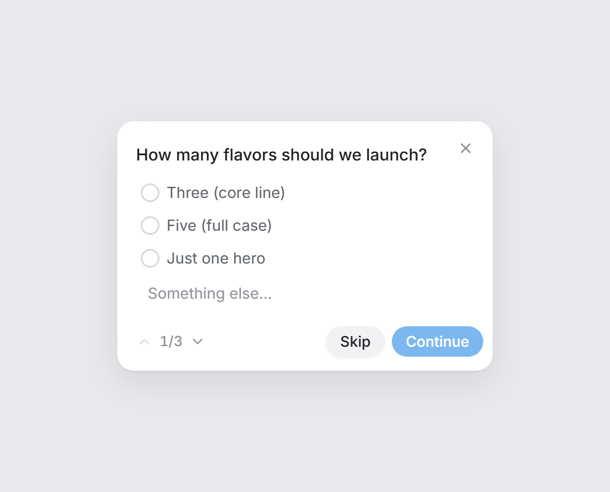

# Approval Card

A human-in-the-loop approval card: **one question at a time**. The stack slides vertically as you move between questions, the card height animates to fit, the step counter rolls like an odometer, and the footer uses pill actions (a quiet **Skip** and an accent **Continue**). Single-choice questions auto-advance; multi-select questions wait for an explicit Continue. Every question also accepts a free-text "something else" answer.



## Live demo

- **Approval Card demo (this repo's Vite app):** run it locally with `npm run dev`
- **Draggable profile list (standalone HTML):** <https://sxn506.github.io/sxn/>

The static page lives at `docs/index.html` and is published by GitHub Pages, which serves the `main` branch's `/docs` directory. It has no build step — edit the file, push, and the page updates.

## Source and attribution

This repository is a **runnable packaging of a third-party component**, not an original work:

| Item | Origin |
|---|---|
| `ApprovalCard` | [Beautiful UI](https://www.beautifului.dev) registry — `approval-card` |
| `Button` | Beautiful UI registry — `button` |
| `GlideMenu` | Beautiful UI registry — `glide-menu` |
| Design tokens / foundation CSS | Beautiful UI registry — `foundation` |

Upstream install command, if your project already uses [shadcn](https://ui.shadcn.com):

```bash
npx shadcn add https://www.beautifului.dev/r/approval-card.json
```

**License status: not stated by the upstream registry.** The registry JSON carries no `license` field and no LICENSE file was found for Beautiful UI, so this repository does **not** grant you rights to the component code — that comes from the upstream author. If you intend to reuse, redistribute, or ship this commercially, confirm terms with Beautiful UI first. If a license is later published upstream, update this section.

What this repo adds on top of upstream: a Vite + Tailwind v4 harness so the component renders standalone, plus the small corrections listed under "Fidelity notes".

## Quick start

```bash
npm install
npm run dev      # http://localhost:5173
```

```bash
npm run build    # type-check + static bundle into dist/
npm run preview
```

## What's in here

```
src/
├── components/
│   ├── primitives/
│   │   ├── ApprovalCard.tsx   # the component (upstream target path)
│   │   └── GlideMenu.tsx      # gliding hover layer (upstream)
│   ├── atoms/Button.tsx       # pill button, cva variants (upstream)
├── lib/utils.ts               # cn() — clsx + tailwind-merge
├── index.css                  # Beautiful UI foundation: tokens + base + utilities
├── App.tsx                    # demo harness
└── main.tsx
```

File placement mirrors the registry's `target` paths (`components/primitives/ApprovalCard.tsx`, `components/atoms/Button.tsx`, `components/primitives/GlideMenu.tsx`), so a shadcn install elsewhere lands on the same structure.

## Props

```ts
type ApprovalQuestion = {
  q: string;
  type: "radio" | "check";
  options: string[];
};

<ApprovalCard
  questions={questions}               // defaults to the 3-question ice-cream demo
  labels={{ skip, continue, send, customPlaceholder, sentMessage }}
  onSubmitted={(answers) => {}}       // Record<questionIndex, optionIndexes>
  onAnswerChange={(qi, answer) => {}} // fires on every toggle
  resettable={true}                   // show "Start over" after sending
/>
```

Answers come back as `Record<number, number[]>` keyed by question index, holding selected option indexes.

## Fidelity notes

Changes made relative to the registry payload, all of them necessary to run standalone:

1. **`React.ReactNode` → `ReactNode`.** The upstream `Ico` helper annotates `path: React.ReactNode` while importing only named exports from `react`. Under `verbatimModuleSyntax` / bundler resolution that is a TS2686 error ("refers to a UMD global, but the current file is a module"), so the type is imported explicitly. Behavior is identical.
2. **`@import "shadow-plugin/unprefixed"` replaced by an explicit `--shadow-xs…lg` scale.** The foundation CSS pulls in a third-party shadow package. The `--shadow-xs…lg` values are defined inline instead so the repo has one fewer dependency; `--shadow-btn` / `--shadow-card` still compose from them exactly as upstream does.
3. **`--font-inter` / `--font-mono-face` given local values.** These are normally injected by the host app's font loader (Next.js `next/font`); without them the `font-family` declaration would resolve to nothing.
4. **Component-specific blocks removed from the foundation.** Upstream `foundation.css` also carries CSS for unrelated components (FilterTable, StreamText, InsightCards, records grid). Only the generic foundation is kept.

Not changed: the card's logic, timing constants, animation easing, markup and class names — those are verbatim upstream.

## Implementation notes

Three details make the card feel right:

1. **Height animation without measuring every question.** Each question is a row in a flex column with a fixed 26px gap. The card measures the active question's `offsetHeight` and `offsetTop`, clips the viewport to that height, and translates the column by `-offsetTop`. One measurement drives both, so they stay in sync and the gap is accounted for.
2. **No flash on mount.** Before the first measurement only the active question is mounted; mounting all of them would briefly render the card at full stacked height and then shrink.
3. **The odometer is per character.** `RollingDigits` splits the value into characters and animates only the ones that changed, using a two-cell vertical strip per digit. Direction comes from the numeric delta, so stepping back rolls downward.

`prefers-reduced-motion` is respected: the height and slide transitions are disabled and only state changes remain.

## Known gaps

- **Free-text answers are not reported.** `onSubmitted` returns only the selected option indexes; values typed into "Something else…" stay in internal state. Wire them into the payload if you need them.
- **`variant?: string` prop is accepted but unused** — it appears in the props type but is not destructured.
- **The demo stage shows the foundation's diagonal stripe background.** That is upstream's default `body` style. Drop the `background-image` rule in `src/index.css` if you want a flat canvas.

## Theming

All colors, radii, shadows and easing live in the `:root` / `.dark` token blocks plus the `@theme inline` mapping at the top of `src/index.css`. Toggle dark mode by putting `class="dark"` on the `<html>` element. Nothing about the card is hardcoded in the component.
